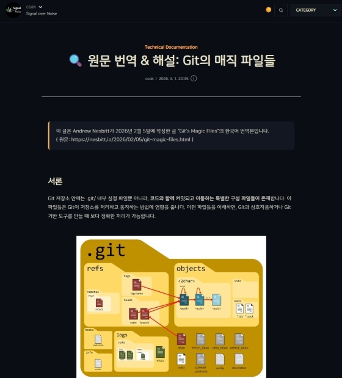
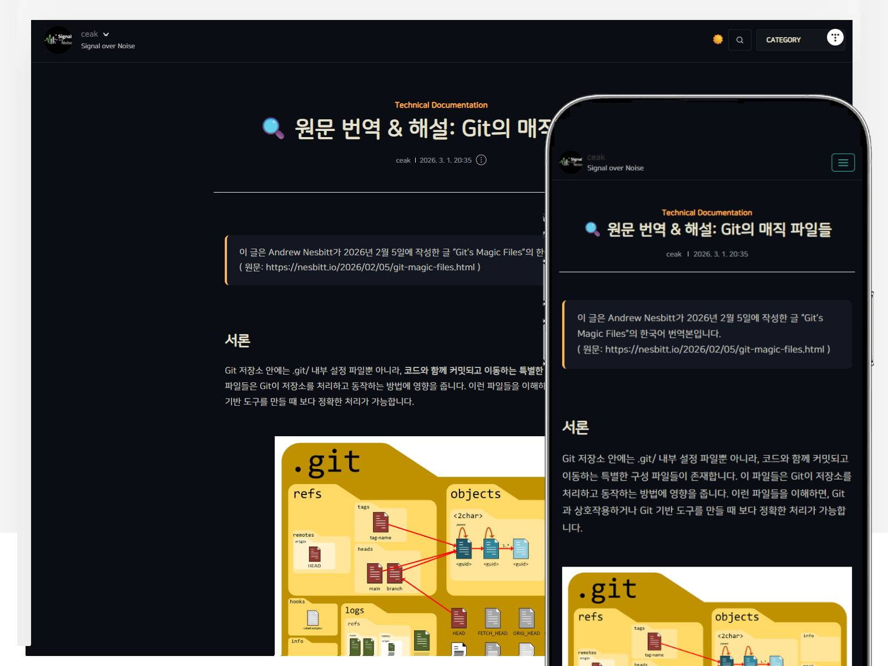

# Signal Ayu Unified

Tistory 기본 #1 스킨을 기반으로 제작된 통합형 Light / Dark 테마입니다.

Signal Ayu Unified는 기존 스킨의 레이아웃과 구조를 변경하지 않습니다.  
대신 색상 체계를 재설계하여 가독성과 대비를 정돈합니다.

구조는 유지합니다.  
색을 정리합니다.

---

## 🎯 프로젝트 목적

- 기본 #1 스킨의 구조적 안정성은 그대로 유지
- Ayu 기반의 의미 중심 색상 토큰 설계
- Light / Dark 모드 통합 아키텍처 구성
- 장문 기술 글에 최적화된 대비 구조
- 불필요한 시각적 장식 제거

---

## ✨ 주요 특징

- Ayu Light / Ayu Dark 통합 토큰 시스템
- `html[data-theme="light"]` / `html[data-theme="dark"]` 기반 테마 전환 구조
- 하드코딩 색상 최소화 (CSS 변수 중심 설계)
- sprite filter 방식 미사용 (SVG 아이콘 교체)
- 코드 블록 / 인라인 코드 대비 개선
- 인용구 및 테이블 가독성 정돈
- 모바일 환경 대응 보정
- 오버라이드 기반의 가벼운 구조

---

## 🌓 테마 시스템 구조

이 테마는 다음 구조를 사용합니다:

```

html[data-theme="light"]
html[data-theme="dark"]

```

Light / Dark는 동일한 의미 체계를 공유하며,  
색상 값만 다르게 매핑됩니다.

모든 색상은 CSS 토큰으로 관리되며,  
직접적인 색상 하드코딩은 지양합니다.

---

## Screenshots

### Dark Mode



---

## 📦 설치 방법

1. GitHub Releases에서 최신 ZIP 파일 다운로드
2. 티스토리 관리자 → 꾸미기 → 스킨 → 스킨 등록
3. ZIP 파일 업로드
4. 미리보기 확인 후 적용

> 이 테마는 **Tistory 기본 #1 스킨 전용**입니다.

---

## 🗂 버전 정책

- v2.x → Light / Dark 통합 아키텍처
- v1.x → Ayu Dark 전용 오버라이드

---

## 📄 라이선스

본 테마는 Tistory 기본 #1 스킨(MIT License)을 기반으로 제작되었습니다.  
원 저작권은 해당 제작자에게 있습니다.

Signal Ayu Unified는 ceak에 의해 수정 및 통합 설계되었습니다.

## 소스 및 검증

- 배포 원본은 루트의 `skin.html`, `style.css`, `images/`입니다.
- `my/skin.html`은 개인 작업용 사본이며 릴리즈 ZIP에 포함하지 않습니다.
- 최초 테스트 준비: `npm install`, `npx playwright install chromium`
- 회귀 검사: `npm test` (설치된 Edge를 사용하려면 `TEST_BROWSER_CHANNEL=msedge` 지정)
- 패키징: `bash scripts/build_skin_zip.sh`
- 배포 시 `index.xml` 버전과 HTML의 JS 캐시 버전을 함께 갱신합니다.
- 운영본 전용 커스터마이징은 운영 파일을 백업·비교한 뒤 별도로 병합합니다.

## v2.1.2 안정화 후보

최근 공지 카드는 공식 지원 범위인 제목·링크만 표시합니다. 요약·날짜는 일반 공지 상세 템플릿에서 유지합니다.
본문 표는 시스템 표를 제외하고 가로 스크롤 영역으로 감싸며, 명시적인 셀 인라인 스타일은 보존합니다.
목차는 제목이 두 개 이상인 일반 글·공지·정적 페이지에 표시하고, 잠긴 보호글과 목록에서는 숨깁니다.

검증 환경은 Node.js 22 이상 및 Python 3입니다. `npm ci`와 `npx playwright install chromium` 후 다음을 실행합니다.

```sh
npm run check
npm test
npm run build
npm run verify:zip
```

이미 같은 버전 ZIP이 있을 때 빌드는 `-local-날짜.zip`을 생성합니다. 이 파일은
`python3 scripts/verify_zip.py releases/생성된파일.zip`으로 따로 검증할 수 있습니다.
GitHub Actions는 커밋된 후보 ZIP과 새로 빌드한 ZIP을 모두 검증합니다.
운영 확인 절차와 자동 검증 범위는 [v2.1.2 검증 보고서](docs/STABILIZATION_v2.1.2.md)를 참조하세요.
